  

  
  
  

I like making small programs that solve a problem I actually have. Most of what I build is in Python, with HTML, CSS and JavaScript when something needs an interface.

## What I use

  

## Projects

Everything I make goes under the name Synthex (SX for short).

- **[Synthex AE Macro](https://github.com/icalx212/Synthex-Anime-Expeditions-)**: a macro made for Anime Expeditions on Roblox
- **[Synthex Piano](https://github.com/icalx212/Synthex-Piano)**
- **[SX-Grow a Garden 2](https://github.com/icalx212/SX-Grow-a-Garden-2)**

## Right now

- Learning C++ by solving problems, a few at a time
- Building new Synthex projects

## Stats

  

